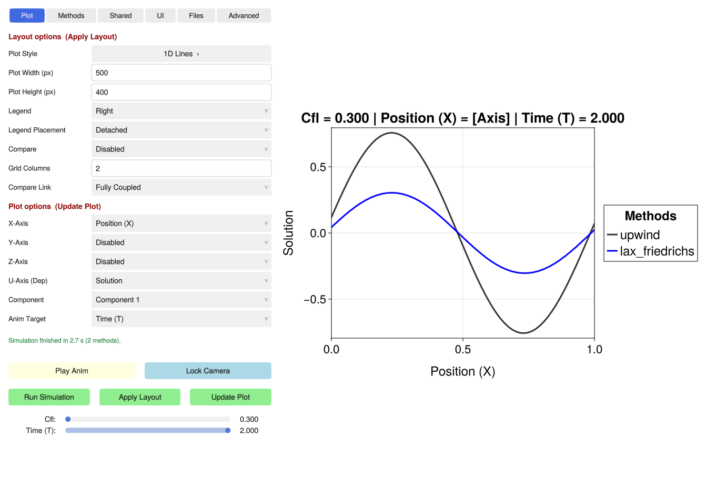

# PDEStudio Control Panel Overview

The `PDEStudio` interface is a single window: the control panel on the left, the plots on the right. The top of the
control panel is a row of tabs; below the selected tab, the controls you need all the time are always visible.

## The Tabs

| Tab | Contents |
| :--- | :--- |
| **Plot** | One option per row, in two sections. *Layout options*: the **plot style** (the button opens a page of every supported style, grouped by Lines, Scatter, Contour, Heatmap and Volume; click one to choose it), plot width and height and the number of grid columns (any number), legend and its placement, and multi-plot comparisons; *changes here require a click on **Apply Layout** to rebuild the plot grid*, which is the expensive step (especially in a browser with WGLMakie). *Plot options*: the independent axes (X, Y, Z), the dependent field (U-Axis), its component and the animation target; changes update the data without rebuilding the plot grid (**Update Plot**). Details: [Rendering](rendering.md). |
| **Methods** | Every method of the configuration with an **active / off** button (filter: **Show: active / disabled / all**) and **Edit ›** for its parameters (also of inactive methods); **Order ▲▼** shows the active methods in drawing order (legends, colours, the *Methods* comparison) with ▲ ▼ to move them. Details: [Editors](editors.md). |
| **Shared** | The shared parameters of the simulation (`config.shared`), one row each. The sweep and the other fields of the configuration are in the **Advanced** tab. Details: [Editors](editors.md). |
| **UI** | The look and the display names, with a fixed overview: *General* (fonts, HUD, outliers), *Labels* (*Plot*: title and axis labels; display names of components, variables and methods), *Axes* (every axis variant: 1D, 2D/3D, Z) and *Plot styles* (one page per plot type). The pages of the active plot are highlighted. |
| **Files** | The **Name / path** box (exports, presets, CSV files) and the **Description** of a preset you save; **Load CSV** (or drop the file anywhere on the window), **Export** and **Settings ›** (export formats, image resolution, animation length, …); **Resolution ›** (points per dimension of the data and of the references); all presets: **Save / Reset / Presets ›** for simulation presets (the physics) and look presets (the visual settings). *Presets ›* lists the saved presets with **Apply** and **Edit ›**, which opens the rows of the preset file. Details: [File Operations](file_ops.md), [Presets](presets.md). |
| **Advanced** | The `SimulationConfig` itself, without the studio's conveniences: `shared`, `varied` (the sweep), the fields (`defaults`, `reference`, …) and the list of all methods, active or not. Values are Julia literals with their types; keys and methods can be added and deleted. Details: [Editors](editors.md). |

The *Methods*, *Shared*, *UI* and *Advanced* tabs and the pages of the *Files* tab use the same editor: a page lists
entries as rows (name, value, a button), an overview has one button per page.

## Always Visible

*   **Status line** (below the tab content): the result of the last action, coloured by outcome: green for done,
    orange for warnings (e.g. a value that was refused, and why), red for errors. Edits, method changes, presets,
    simulation runs, CSV loads and exports report here; everything is also written to the Julia log.
*   **Sliders** (at the bottom): one slider per swept parameter and per physical dimension, scaled to the values of
    the active datasets. Only sliders with a choice to make are shown: unused parameter sliders, dimensions on a plot
    axis and dimensions the data doesn't have are hidden. Text-valued sweeps (e.g. scheme names) get index sliders that display the swept value. Details:
    [Exploration](sliders.md).
*   **Camera & Animation:** a one-click animation player that sweeps the chosen `Anim Target`. **Lock Camera**
    freezes the view (2D limits, or 3D azimuth, elevation and bounds) for perfectly stable video exports.
*   **Reactive Triggers:** the execution buttons (`Run Simulation`, `Apply Layout`, `Update Plot`) are tied to a
    background state machine. When a change requires a backend recalculation, a structural layout change or a
    redraw, the corresponding button turns yellow to show that the plot is out of sync.

A window opens on the **Plot** tab. The tab can also be selected from code with `PDEStudio.show_tab!(:methods)`
(`:plot`, `:methods`, `:shared`, `:ui`, `:files`, `:advanced`).
